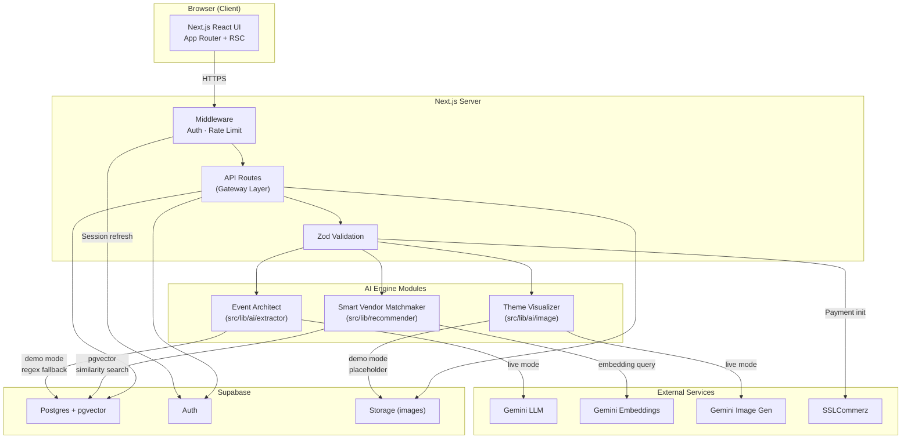
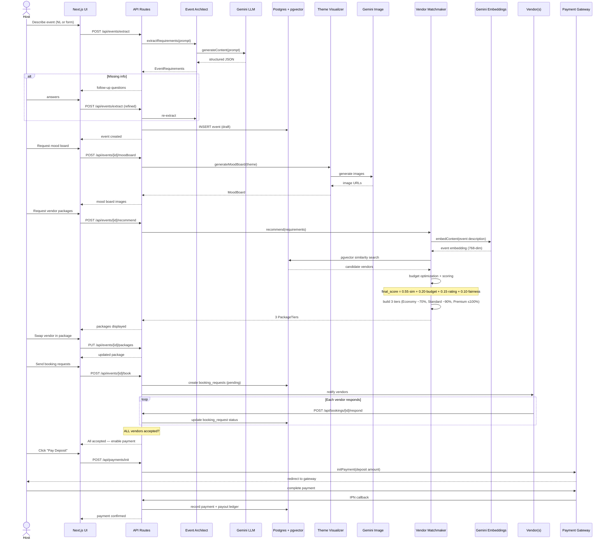
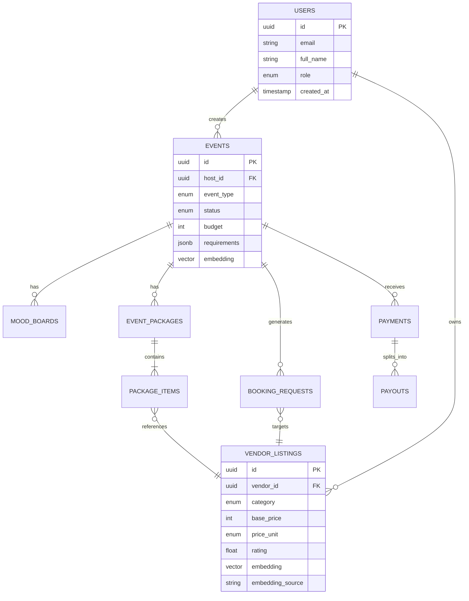

# PlanKori Architecture

> Reference architecture for the AI-Powered Smart Event Management and Vendor Recommendation Platform.
> See [docs/SPEC.md](../docs/SPEC.md) for the full product specification.

---

## System Architecture

---

## Main Flow — Sequence Diagram

---

## Entity-Relationship Diagram

> **Placeholder** — will be completed after the database schema migration is created.

---

## Layer Responsibilities

| Layer                   | Responsibility                                                                                   |
| ----------------------- | ------------------------------------------------------------------------------------------------ |
| **UI (React RSC + Client)** | Rendering, form inputs, real-time chat, responsive layout. No direct DB or AI access.       |
| **Middleware**          | Session refresh, route protection, rate limiting. Runs on every matched request.                 |
| **API Routes**          | Gateway: Zod validation, auth checks, orchestration. Calls AI engine and DB.                     |
| **AI Engine**           | Event Architect (extraction), Theme Visualizer (images), Vendor Matchmaker (recommendations).    |
| **Supabase**            | Postgres (data + pgvector), Auth (JWT sessions), Storage (images).                               |
| **External Services**   | Gemini API (LLM, embeddings, images), SSLCommerz (payments).                                     |

---

## AI Technique → Implementation File Map

| Technique                     | File(s)                                       | Status      |
| ----------------------------- | --------------------------------------------- | ----------- |
| LLM chat extraction           | `src/lib/ai/extractor.ts`                     | Planned     |
| LLM demo fallback (regex)     | `src/lib/ai/demo-extractor.ts`                | Planned     |
| Semantic embeddings (live)     | `src/lib/ai/embeddings.ts`                    | Planned     |
| Semantic embeddings (demo)    | `src/lib/ai/demo-embeddings.ts`               | Planned     |
| Text-to-image (live)          | `src/lib/ai/image.ts`                         | Planned     |
| Text-to-image (demo)          | `src/lib/ai/demo-image.ts`                    | Planned     |
| pgvector similarity search    | `src/lib/recommender/search.ts`               | Planned     |
| Scoring & ranking             | `src/lib/recommender/scoring.ts`              | Planned     |
| Budget optimization / tiers   | `src/lib/recommender/tiers.ts`                | Planned     |
| AI mode router                | `src/lib/ai/index.ts`                         | Planned     |

---

## Design Decisions

### Why Next.js full-stack?

- **Single deployment** on Vercel: UI, API routes, middleware, ISR — one repo, one deploy.
- **React Server Components** reduce client JS bundle; server-only AI/payment code never reaches the browser.
- **App Router** provides nested layouts, loading states, and streaming for the complex dashboard UX.

### Why pgvector?

- Supabase Postgres natively supports `pgvector` — no separate vector DB needed.
- Vendor embeddings (768-dim) are stored alongside relational data, enabling **hybrid queries** (vector similarity + budget range + category filter) in a single SQL statement.
- Scales to thousands of vendors without additional infrastructure.

### How the 5 % Budget Cap Is Enforced

1. `BUDGET_CAP_PERCENT` defaults to 105.
2. During package assembly (`src/lib/recommender/tiers.ts`), the total price of all vendors in a tier is compared against `budget × (BUDGET_CAP_PERCENT / 100)`.
3. If the total exceeds the cap, the most expensive vendor in the least-critical category is replaced with a cheaper alternative.
4. The cap is re-checked after every vendor swap.
5. The API route **rejects** any package submission that violates the cap.

### How Fairness Is Implemented

- Vendors registered within `NEW_VENDOR_DAYS` (default 60) receive a `fairness_boost` of 1.0 in the scoring formula.
- This gives new vendors a 10 % score advantage (`0.10 × 1.0`) to help them compete against established vendors with more reviews.
- After the boost period expires, the fairness component drops to 0, and the vendor competes on merit alone.
- The admin dashboard (`/admin/ai`) shows fairness metrics and can adjust `NEW_VENDOR_DAYS`.

---

## Security & Privacy Notes

1. **Server-only secrets**: Gemini API key, Supabase service role key, SSLCommerz credentials are **never** exposed to the client. They are read only in API routes and server utilities via `src/lib/config.ts`.
2. **Row-Level Security (RLS)**: Supabase RLS policies ensure hosts see only their own events, vendors see only their own listings and bookings, and admins have full access.
3. **No card data**: PlanKori never receives, stores, or processes card numbers. The host is redirected to the payment gateway's hosted page.
4. **Input validation**: Every API route validates request bodies with Zod schemas before processing.
5. **Auth middleware**: The Next.js middleware refreshes Supabase auth tokens and redirects unauthenticated users away from protected routes.
6. **Rate limiting**: API routes that call the Gemini API are rate-limited to prevent abuse and cost overruns.
7. **Embedding isolation**: Live and demo embeddings are never mixed. The `embedding_source` column ensures queries match the correct embedding space.
8. **CSRF protection**: Supabase Auth uses `httpOnly` cookies with `SameSite=Lax`, and payment IPNs are validated server-side.
